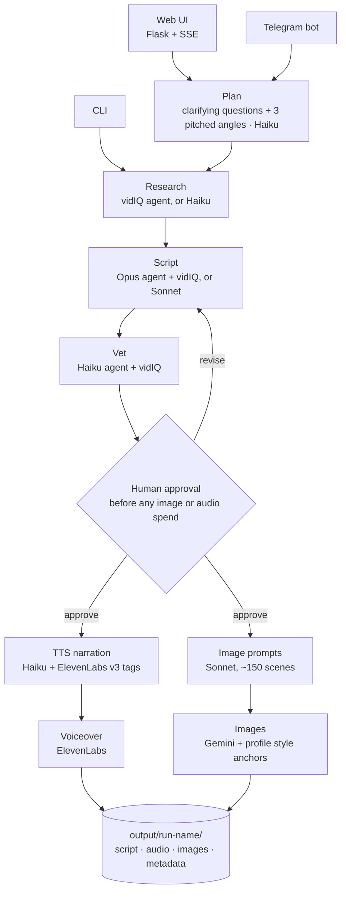

# YouTube Pipeline

[](https://github.com/marcusmrno/youtube-automation-pipeline/actions/workflows/tests.yml)


An asset pipeline for a faceless educational YouTube channel. Input a topic — the system researches it, writes a structured script, generates ~150 style-consistent images, and records a voiceover, leaving a complete asset set to drop into an editor. Every stage is automated, resumable, and runs on a multi-model AI stack.

https://github.com/user-attachments/assets/dae0a1a7-0977-4655-9fb9-d1b2fd3c7d9c

**Scope:** the pipeline produces images, audio, script, and SEO metadata — it does not render a video file. Final assembly happens in a video editor.


*Every frame from one run, in order, generated with the bundled `example` profile. Nothing was
hand-picked or retouched — the style consistency and the in-image text come from the profile's
`art_style_block` and `scene_rules`, not from post-processing.*

The same run, cut together with its generated narration — first 30 seconds, sound on:

https://github.com/user-attachments/assets/a6910944-f411-41ac-9444-8ed1ffc1ff8b

---

## How it works



Each stage writes its result to the run folder, so a stopped run resumes from the first missing file.
Voiceover and images generate in parallel. Everything stylistic — tone, characters, art style,
voice — comes from a YAML **channel profile**, not from the code.

## Tech Stack

| Layer | Technology |
|-------|-----------|
| **Orchestration** | Python — threaded pipeline with checkpoint-based resumability |
| **LLM** | Anthropic Claude — Opus writes vidIQ-backed scripts; Sonnet writes scripts without vidIQ, revisions and image prompts; Haiku does research, planning, TTS narration, vetting and metadata (the profile creator uses Sonnet 4.6) |
| **AI Agents** | Claude Agent SDK, connected to vidIQ's MCP server as a tool source — script generation, SEO vetting, keyword research |
| **Image generation** | Google Gemini (`gemini-3.1-flash-image` / `gemini-3-pro-image`) — ~130-150 images per 12-minute video with style anchor references, generated in parallel |
| **Text-to-speech** | ElevenLabs v3 — chunked MP3 generation with custom audio tags for emotion and pacing |
| **Web UI** | Flask + vanilla JS — real-time SSE log streaming, image gallery, lightbox, script review modal |
| **Bot interface** | python-telegram-bot — planning, production, resume, metadata and downloads via Telegram with inline keyboard interactions |

---

## Design highlights

- **Checkpoint-based resumability** — the pipeline reads the run folder to see what's missing and generates only that; re-running a finished topic is refused instead of overwriting it
- **Human approval gate** — research and scriptwriting are cheap; images and audio aren't, so production waits for an approved script
- **Per-task model routing** — Opus for the agentic script pass, Sonnet for long-form writing and image prompts, Haiku for everything short
- **Three front ends, one core** — the web UI, Telegram bot and CLI call the same `run_pipeline` / `resume_pipeline` / `run_from_script` functions
- **Profile-driven style** — a profile's character sheet and anchor images go into every image call, which is what keeps ~150 images in one consistent style

---

## Quickstart

Requires Python 3.11+.

```bash
pip install -r requirements.txt
cp .env.example .env
```

```env
ANTHROPIC_API_KEY=sk-ant-...
GOOGLE_API_KEY=...
ELEVENLABS_API_KEY=...
ELEVENLABS_VOICE_ID=...
# optional — enables agent research + vetting; leave empty for standard Claude research
VIDIQ_API_KEY=
# optional — for bot.py: token from @BotFather, your numeric user ID from @userinfobot
TELEGRAM_BOT_TOKEN=
TELEGRAM_USER_ID=
```

Then pick a front end:

```bash
python ui.py                              # web UI at http://localhost:7860
python bot.py                             # Telegram bot
python pipeline.py "why humans sleep"     # CLI
```

`profiles/example` is a complete, annotated profile to start from, or run `python create_profile.py`
to have Claude build one (including anchor images) from a description of your channel.

**[USAGE.md](USAGE.md)** has the full reference: every UI mode, bot command and CLI flag, the
profile schema, the profile creator and the output folder layout.

---

## Project structure

```
├── pipeline.py           # orchestration: run / resume / status / regenerate, CLI
├── writing.py            # Claude text calls: research, planning, script, revise, TTS, image prompts
├── prompts.py            # prompt builders — pure functions, no API calls
├── agents.py             # Claude Agent SDK runners on vidIQ's MCP server (script + vet)
├── images.py             # Gemini image generation with anchor references
├── voiceover.py          # ElevenLabs voiceover: chunking, MP3 splicing
├── metadata.py           # titles, description, hashtags, thumbnails
├── channel_profile.py    # Profile dataclass + YAML loader
├── ui.py                 # Flask web UI + SSE endpoints
├── templates/index.html  # web UI front end (vanilla JS)
├── bot.py                # Telegram bot
├── create_profile.py     # profile creator CLI → profile_creator/
├── profiles/example/     # annotated example profile
└── tests/                # pytest suite, runs in CI on Python 3.11 and 3.12
```

## Tests

```bash
pip install pytest
python -m pytest tests -q
```

## License

MIT — see [LICENSE](LICENSE).
